# Ressac

Battle royale mobile pour Android dans l'esprit du mode Résurgence : une petite île, des parties
courtes, et on revient en jeu après une mort tant que la réapparition est ouverte. Solo contre
des bots d'abord, multijoueur ensuite. Fait avec Godot 4.6 (rendu « Compatibility », adapté aux
GPU Mali), avec les graphismes et les sons de [Dernière Vague](https://github.com/sbkz34/derniere-vague).

**Télécharger l'APK :** [ressac.apk](../../releases/latest/download/ressac.apk)

- [Plan du projet](PLAN.md) — règles gardées (shop, loadouts, cancel slide, parachute), jalons, choix techniques.
- [La carte](docs/carte.md) — l'Île du Lazaret, ses lieux et comment la modifier.

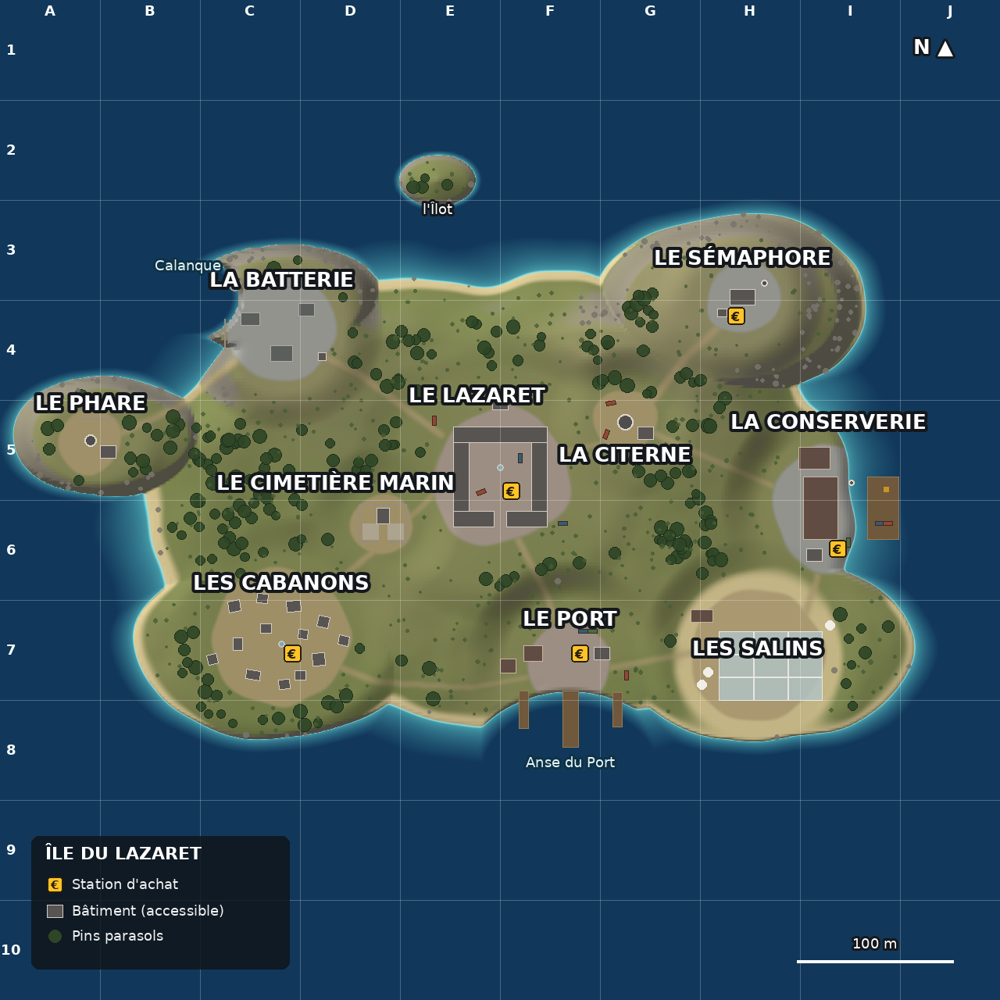

## État actuel : jalon 4, les bots

On joue maintenant **contre des bots** : jusqu'à 23 adversaires (24 combattants), réglables au
lobby (aucun, 7, 15 ou 23) avec trois niveaux de difficulté. Les bots sont des combattants comme
vous — mêmes règles de mouvement, d'armes, d'armure, de butin et de réapparition — pilotés par
une petite IA (`scripts/bot.gd`) qui remplit les mêmes commandes qu'une manette :

- **Saut** : chacun choisit un lieu (les plus riches attirent, mais ils se répartissent), saute
  de l'avion au plus près, ouvre tôt s'il est loin et se dirige sous la voile.
- **Pillage** : armes meilleures que les siennes, munitions qui lui servent, plaques, argent,
  coffres ; déplacements par un **maillage de navigation** de toute l'île (escaliers, étages,
  quais), glissades et cancel slides en courant, escalade quand ça coince.
- **Achats** : avec 4 500 €, il va à la station la plus proche, achète un largage, l'ouvre et
  prend une classe (et un gilet ou une grenade s'il reste de l'argent). Il récupère aussi le
  largage offert en phase 2.
- **Brume** : il rejoint le prochain cercle avant qu'il se referme.
- **Combat** : il voit dans un champ de 115° jusqu'à 70 / 100 / 130 m selon la difficulté, pas à
  travers les murs ni les fumigènes. Temps de réaction (0,65 / 0,4 / 0,25 s), visée imprécise
  qui s'affine pendant l'échange, rafales, visée épaulée au-delà de 12 m, pas de côté, il se
  rapproche ou recule selon la portée de son arme, poursuit, lance des grenades et se replie
  derrière un fumigène pour remettre des plaques. Avec le seul pistolet de départ, il pille
  plutôt que d'aller chercher la bagarre de loin.

Une partie se gagne en étant **le dernier debout** une fois la réapparition fermée (phase 5). En
jeu : le nombre de combattants encore en lice, vos éliminations, le **fil des éliminations** et
un **arc rouge** qui indique d'où viennent les tirs reçus. En fin de partie : votre classement.
Les sons des autres (tirs, pas, réceptions) sont placés dans l'espace.

| | |
|---|---|
| 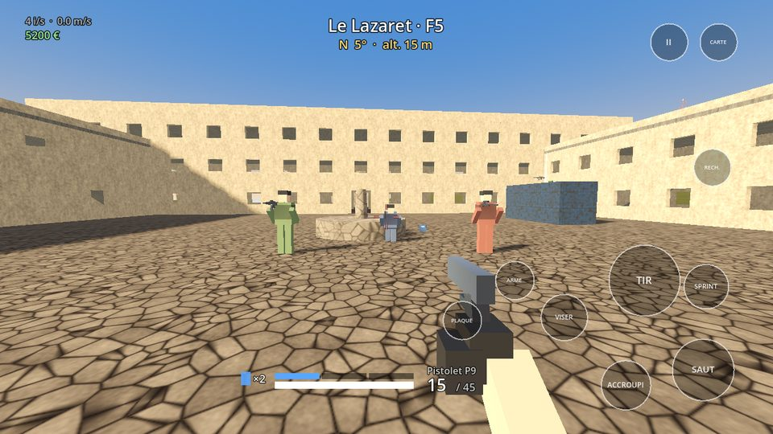 | 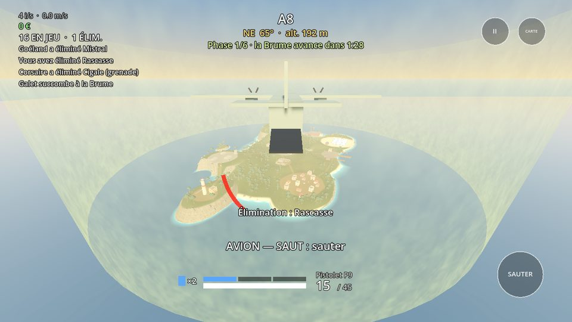 |
| 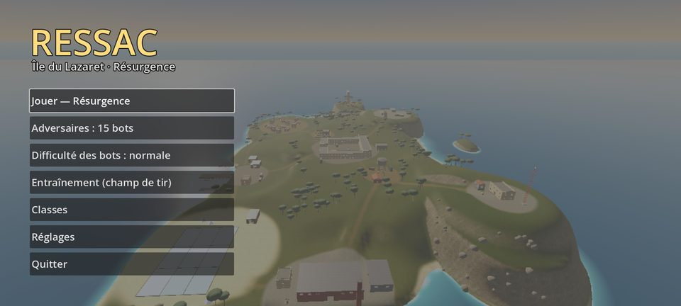 | 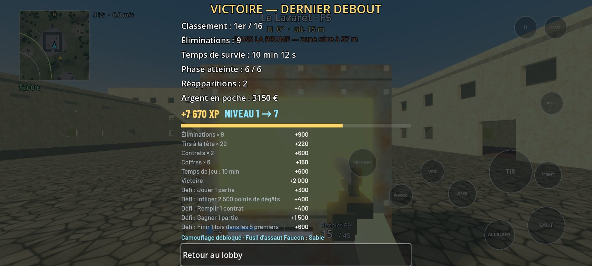 |

### Classes, commandes et réglages

Au lobby, l'écran **Classes** montre les 5 classes avec le rendu de leurs armes (les vrais
modèles du jeu), leurs statistiques en jauges, les atouts et l'équipement en icônes. On change
une arme dans une grille (comparaison avec l'arme équipée : bleu = mieux, orange = moins bien),
les atouts colonne par colonne ; tout est enregistré tout de suite. En partie, un largage de
classe s'ouvre sur un bandeau de 5 cartes en bas de l'écran.

**Accessoires** : 5 emplacements par arme — bouche (silencieux : on n'apparaît plus sur la
mini-carte des autres ; compensateur), canon (long, court), viseur (point rouge, holographique,
lunette ×4), chargeur (étendu, rapide), crosse (stable, légère). Chacun a une contrepartie, visible
dans les jauges. Les armes trouvées en portent selon leur rareté (rare 2, épique 3, légendaire 5),
les armes de classe ceux choisis à l'**armurier** (aperçu 3D et comparaison en direct). Ils se
voient sur les armes, en main, au sol et chez les bots.

Manette : **Y appuyé** change d'arme, **Y maintenu** pose des plaques (la croix haut aussi). Toutes
les touches se changent dans Réglages › Touches (manette et clavier séparément). Réglages ›
Qualité graphique : Performance (rendu 3D à 60 %, sans ombres), Équilibrée (75 %), Qualité (100 %).

| | |
|---|---|
| 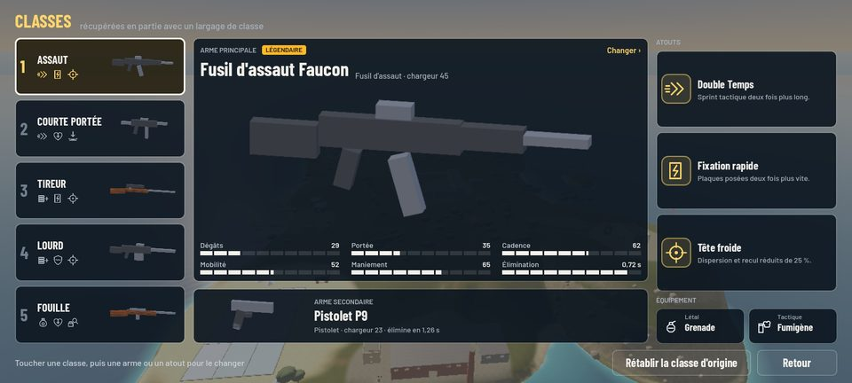 | 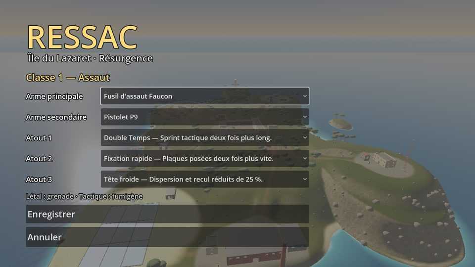 |
| 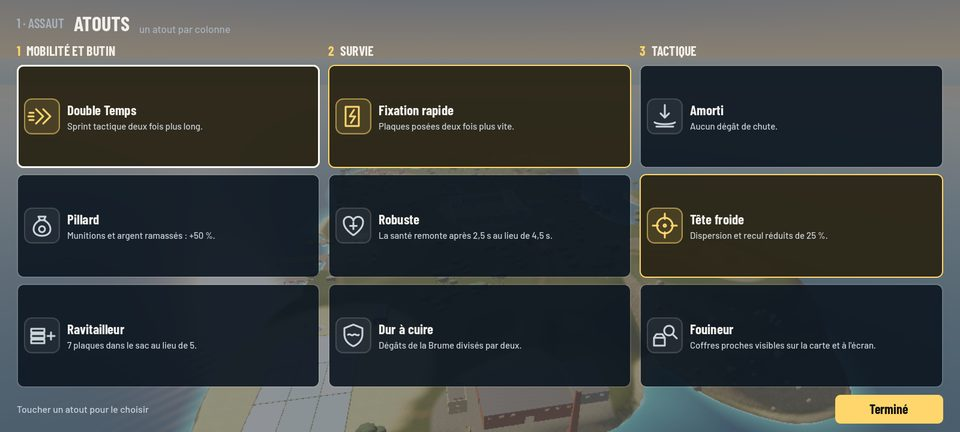 | 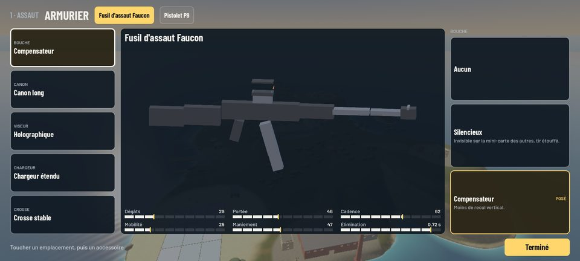 |
| 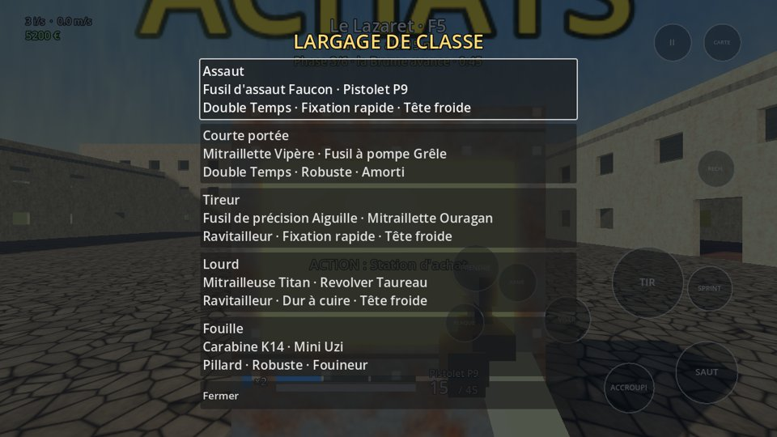 | 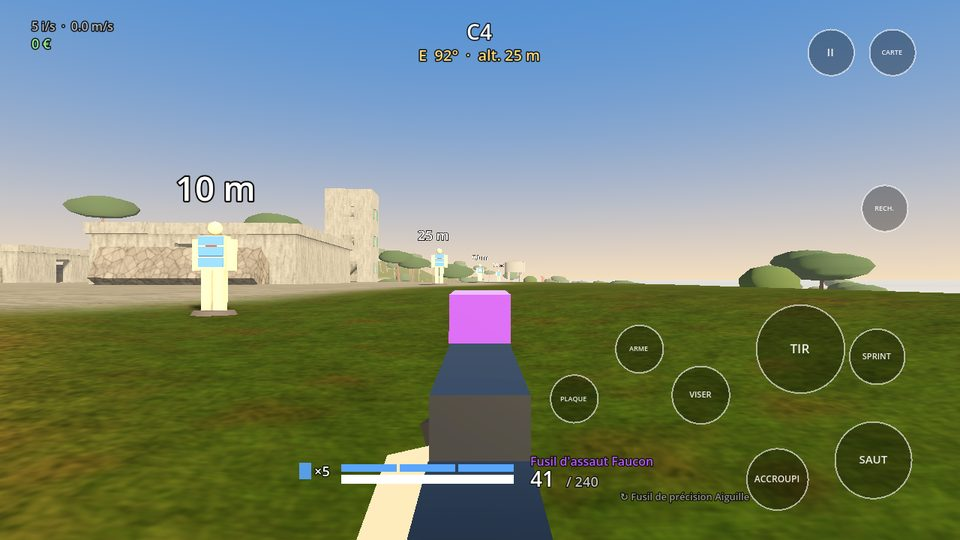 |

### Jalon 3 : les règles de Résurgence

On arrive au **lobby** : jouer une partie, s'entraîner au champ de tir, préparer ses **5 classes**
(arme principale, arme secondaire, un atout par colonne), régler l'affichage.

Une partie : saut d'avion au-dessus de l'île, pillage, puis **la Brume** referme l'aire de jeu en
6 phases (environ 10 minutes) jusqu'à l'un des lieux de fin (Lazaret, Cimetière, Citerne,
Cabanons, Salins). Hors du cercle, on perd de la vie à travers l'armure, de plus en plus vite.
Mort avant la phase 5 : on laisse un sac avec tout son butin et on **revient en chute libre**
dans la zone après 10 à 30 s, avec le pistolet de départ. À partir de la phase 5, chaque vie
compte. Sans adversaires, rester debout jusqu'à la fermeture complète donne la victoire.

L'argent ramassé s'utilise aux **5 stations d'achat** :

| Article | Prix |
|---|---|
| Largage de classe (une caisse descend près de la station ; on y choisit une de ses classes) | 4 500 € |
| Gilet de plaques (3 plaques dans le sac) | 900 € |
| Munitions (tout au maximum) | 500 € |
| Masque à gaz (25 s sans dégâts dans la Brume) | 1 200 € |
| Grenade · Fumigène | 600 € · 400 € |

Un largage de classe est offert à tout le monde au début de la phase 2. Les armes de classe
sont légendaires. Atouts (un par colonne) : **Double Temps**, **Pillard**, **Ravitailleur** ·
**Fixation rapide**, **Robuste**, **Dur à cuire** · **Amorti**, **Tête froide**, **Fouineur**.
Les chutes de plus de 6 m font des dégâts (sauf avec Amorti).

| | |
|---|---|
|  |  |
| 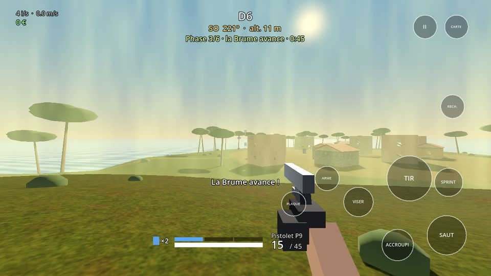 | 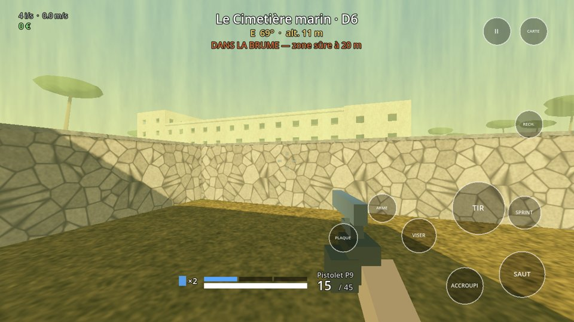 |
| 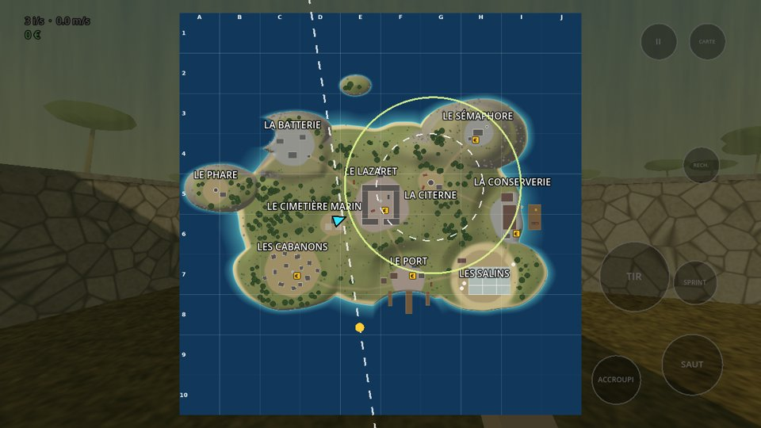 | 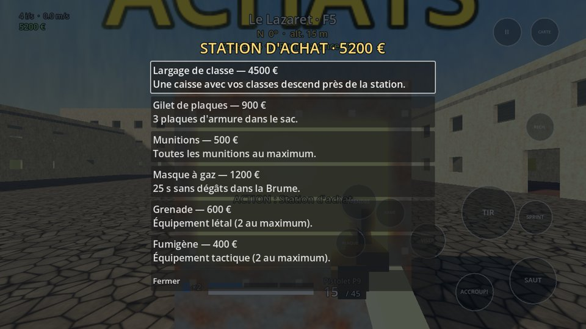 |

### Jalons précédents

Mouvement du jalon 1 : sprint, sprint tactique, glissade et **cancel slide**, escalade de rebords,
accroupi / couché, nage, parachute (ouvrir, couper, rouvrir), redéploiement depuis un point haut.

| Action | Manette | Clavier / souris | Tactile |
|---|---|---|---|
| Se déplacer / regarder | Sticks | ZQSD / souris | Stick à gauche / glisser à droite |
| Tirer / viser | RT / LT | Clic gauche / clic droit | TIR (on peut glisser dessus pour viser) / VISER |
| Ramasser, ouvrir un coffre | X | E ou F | ACTION (apparaît quand c'est possible) |
| Recharger | X (quand il n'y a rien à ramasser) | R | RECH. |
| Changer d'arme | Y | 1, 2, molette | ARME |
| Plaque d'armure (maintenir) | Croix haut | 4 ou X | PLAQUE |
| Grenade · fumigène | RB · LB | G · T | GREN. · FUMI. (quand on en a) |
| Sauter, escalader, sauter de l'avion, ouvrir le parachute | A | Espace | SAUT |
| Accroupi · glissade en courant · annuler la glissade · couper le parachute (maintenir : couché) | B | C | ACCROUPI |
| Sprint (encore une fois en courant : sprint tactique) | L3 | Maj | SPRINT ou stick poussé au bord |
| Carte · pause et réglages | Select · Start | M · Échap | CARTE · II |

**Cancel slide** : en sprint, glisser (B), puis appuyer de nouveau sur B pendant la glissade : on
se relève en sprint sans perdre l'élan, et le sprint tactique est rechargé.

**Combat** : santé 100 qui remonte après 4,5 s sans dégâts, armure jusqu'à 150 en trois plaques
de 50 qui ne remontent pas. Dégâts par zone (tête, torse, jambes) et selon la distance. Marqueurs
de touche : blanc (corps), jaune (tête), bleu (armure), bleu épais (armure brisée), rouge
(élimination). À la manette et au tactile, la visée ralentit sur une cible et se cale dessus
quand on épaule.

| Arme | Type | Coups au torse (armure pleine) | Temps pour éliminer |
|---|---|---|---|
| Fusil d'assaut Faucon | Fusil d'assaut | 9 | 0,72 s |
| Mitrailleuse Titan | Mitrailleuse | 8 | 0,67 s |
| Mitraillette Vipère | Mitraillette | 11 | 0,75 s |
| Mitraillette Ouragan | Mitraillette | 12 | 0,66 s |
| Mini Uzi | Mitraillette | 13 | 0,66 s |
| Carabine K14 | Fusil tactique | 5 | 0,88 s |
| Fusil de précision Aiguille | Fusil de précision | 2 (1 dans la tête) | 1,15 s |
| Fusil à pompe Grêle | Fusil à pompe | 2 à bout portant | 0,85 s |
| Pistolet P9 | Pistolet | 10 | 1,26 s |
| Revolver Taureau | Pistolet | 5 | 1,68 s |

Raretés : commune, rare (bleu), épique (violet), légendaire (or) — chargeur plus grand, moins de
dispersion, visée plus rapide.

| | |
|---|---|
| 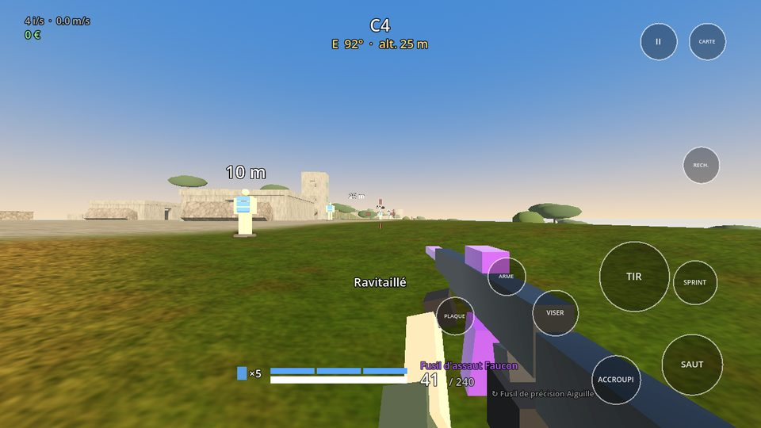 |  |
| 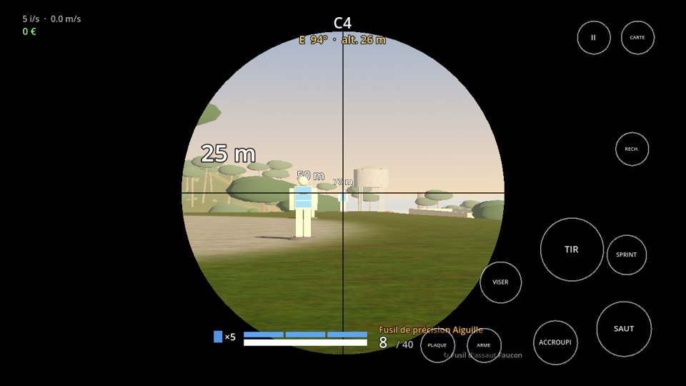 | 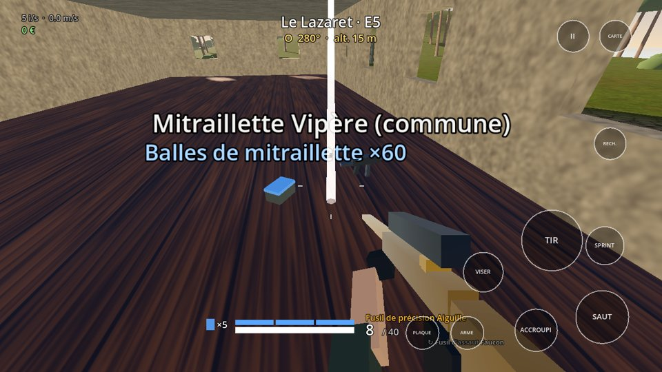 |
| 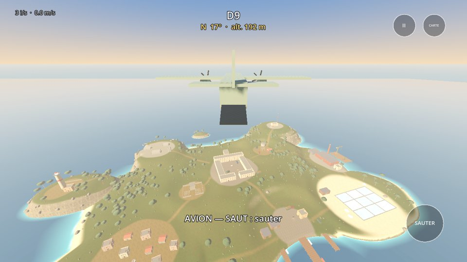 | 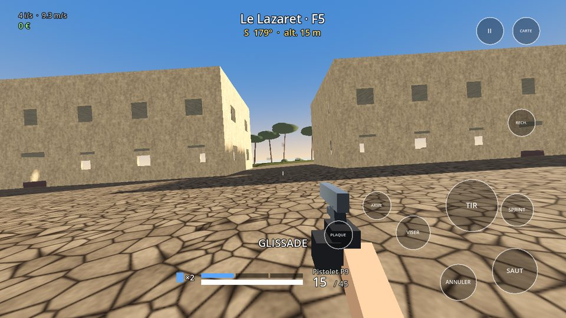 |

## Développement

- `data/ile.json` décrit l'île ; `python3 tools/gen_island.py` génère le relief, les sols, la
  végétation et les cartes (`assets/map/`, `docs/carte.png`).
- `tools/gen_assets.py` (repris de Dernière Vague) génère les textures et les sons.
- Vérifications : `godot --headless --fixed-fps 60 --path . -- --check` (relief, escaliers, glissade,
  cancel slide, sprint tactique, escalade, parachute, redéploiement, avion, nage, drone, interface,
  butin, ramassage, rechargement, balles pour éliminer au champ de tir, tête au fusil de précision,
  plaques, régénération, coffres, chutes, grenade, achats, largage et choix de classe, Brume,
  mort et réapparition, fin de partie et victoire en accéléré, chemins des bots vers chaque lieu et
  les étages, bot qui pille, abat un mannequin, gagne un duel, rejoint la zone sûre, élimination
  créditée au joueur, partie complète à 24 en accéléré).
- Maillage de navigation des bots : `godot --headless --path . -- --bake-nav` (à relancer après
  une modification de l'île) ; il est enregistré dans `assets/map/navigation.res`.
- Réglage des bots : `godot --headless --fixed-fps 60 --path . -- --sim --scale=2` joue une partie
  de 23 bots et affiche ce qu'ils font ; `-- --sim --visee` mesure leur précision.
- Captures de chaque lieu : `godot --path . -- --tour --shots=/tmp/captures`.
- Chaque push sur `main` vérifie l'île, compile l'APK (GitHub Actions) et publie une release.

## Aperçu de l'île

| | |
|---|---|
| 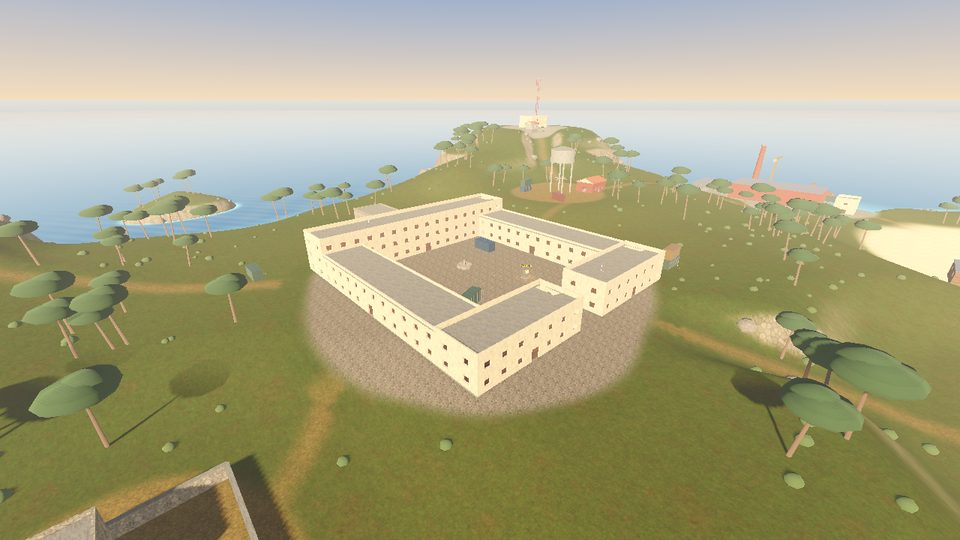 | 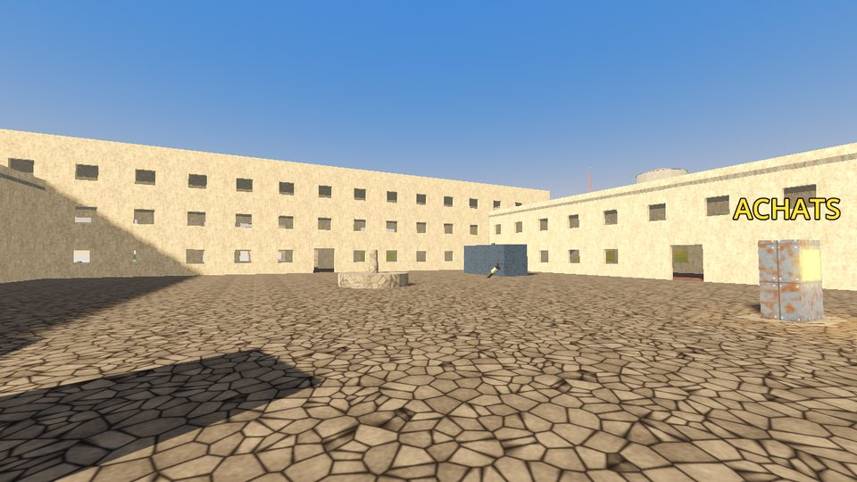 |
| 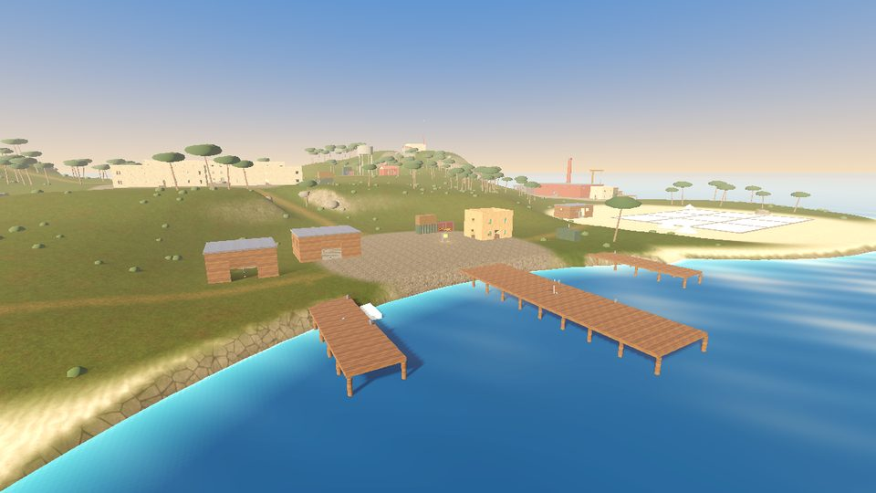 | 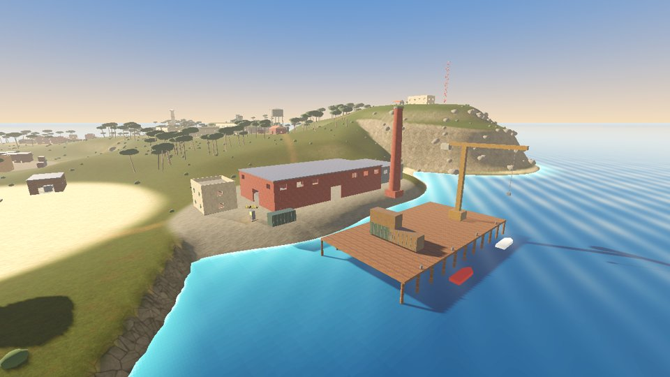 |
| 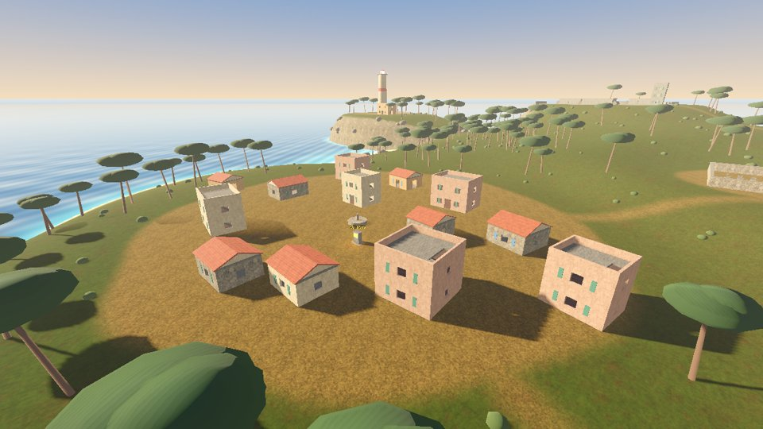 | 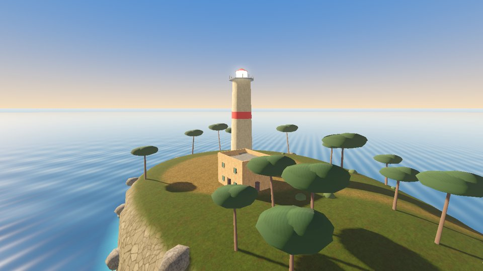 |
