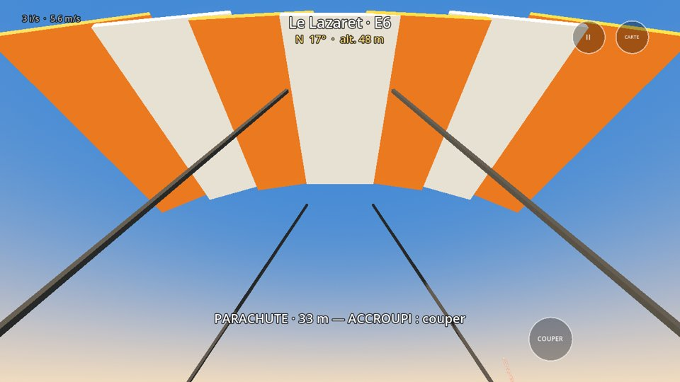
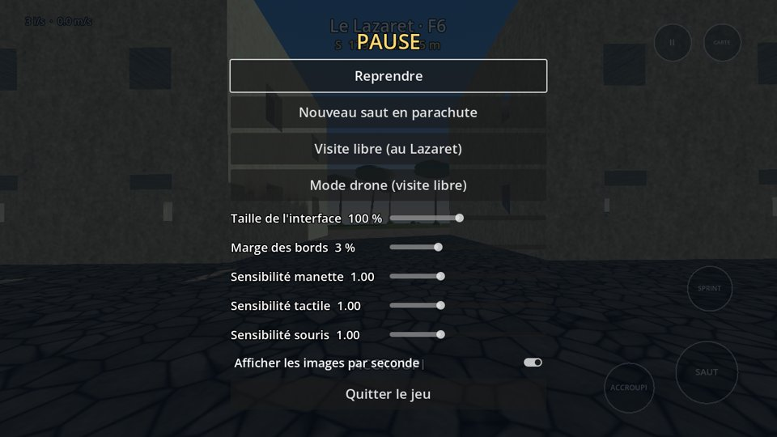

# Ressac

Battle royale mobile pour Android dans l'esprit du mode Résurgence : une petite île, des parties
courtes, et on revient en jeu après une mort tant que la réapparition est ouverte. Solo contre
des bots d'abord, multijoueur ensuite. Fait avec Godot 4.6 (rendu « Compatibility », adapté aux
GPU Mali), avec les graphismes et les sons de [Dernière Vague](https://github.com/sbkz34/derniere-vague).

**Télécharger l'APK :** [ressac.apk](../../releases/latest/download/ressac.apk)

- [Plan du projet](PLAN.md) — règles gardées (shop, loadouts, cancel slide, parachute), jalons, choix techniques.
- [La carte](docs/carte.md) — l'Île du Lazaret, ses lieux et comment la modifier.

## État actuel : jalon 1, le mouvement

Chaque partie commence dans l'avion qui traverse l'île : on saute quand on veut, chute libre
(regarder vers le bas pour plonger), parachute (ouverture automatique vers 40 m, on peut le couper
et le rouvrir). Au sol : sprint, sprint tactique, glissade et **cancel slide**, escalade de
rebords, accroupi / couché, nage. Sauter dans le vide de plus de 12 m de haut permet de rouvrir
le parachute (redéploiement). Le menu pause règle la taille de l'interface, la marge des bords
et les sensibilités ; l'interface respecte la zone sûre de l'écran (encoche, coins arrondis).

| Action | Manette | Clavier / souris | Tactile |
|---|---|---|---|
| Se déplacer | Stick gauche | ZQSD / WASD | Stick à gauche de l'écran |
| Regarder | Stick droit | Souris (clic pour capturer) | Glisser à droite de l'écran |
| Sauter, escalader, sauter de l'avion, ouvrir le parachute | A | Espace | SAUT |
| Accroupi · glissade en courant · annuler la glissade · couper le parachute (maintenir : couché) | B | C | ACCROUPI |
| Sprint (encore une fois en courant : sprint tactique) | L3 | Maj | SPRINT ou stick poussé au bord |
| Carte | Select | M ou Tab | CARTE |
| Pause et réglages | Start | Échap | II |
| Drone de visite | menu pause | F | menu pause |

**Cancel slide** : en sprint, glisser (B), puis appuyer de nouveau sur B pendant la glissade : on
se relève en sprint sans perdre l'élan, et le sprint tactique est rechargé. Sauter pendant la
glissade garde aussi l'élan.

| | |
|---|---|
|  |  |
|  |  |

## Développement

- `data/ile.json` décrit l'île ; `python3 tools/gen_island.py` génère le relief, les sols, la
  végétation et les cartes (`assets/map/`, `docs/carte.png`).
- `tools/gen_assets.py` (repris de Dernière Vague) génère les textures et les sons.
- Vérifications : `godot --headless --fixed-fps 60 --path . -- --check` (relief, escaliers, glissade,
  cancel slide, sprint tactique, escalade, parachute, redéploiement, avion, nage, drone, interface).
- Captures de chaque lieu : `godot --path . -- --tour --shots=/tmp/captures`.
- Chaque push sur `main` vérifie l'île, compile l'APK (GitHub Actions) et publie une release.

## Aperçu de l'île

| | |
|---|---|
|  |  |
|  |  |
|  |  |
